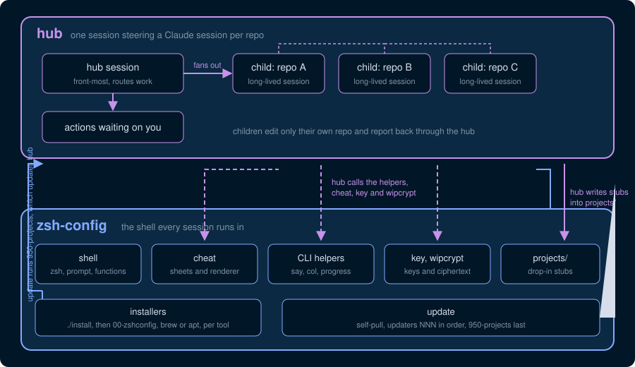
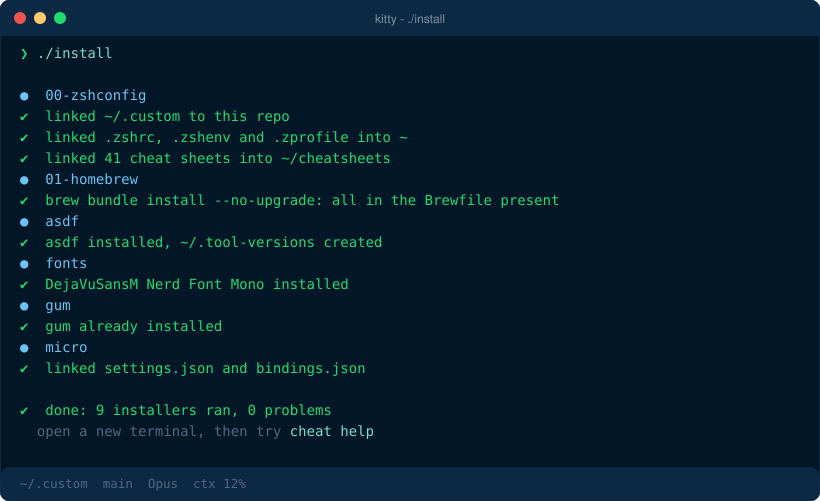
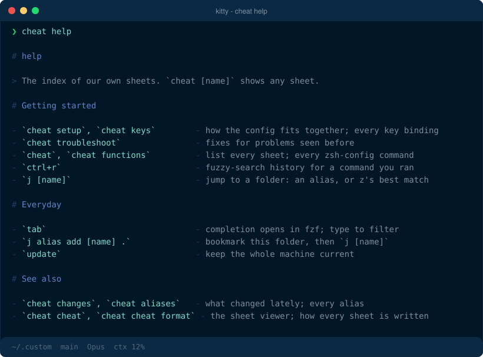
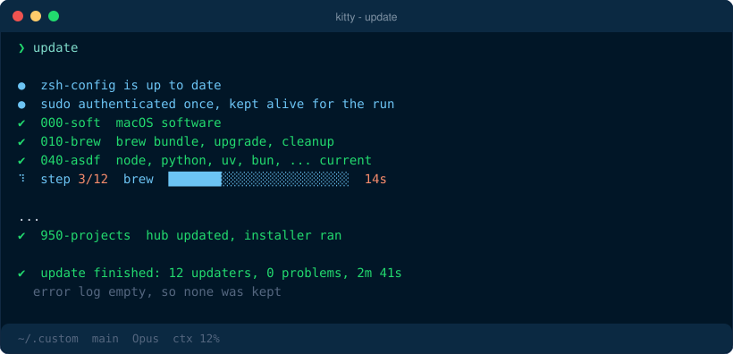

# zsh-config

A personal zsh setup that installs itself as `~/.custom` and keeps the same shell, prompt, tools and cheat sheets on every macOS and Debian family machine.

It exists so that a new machine is one command away from my own environment, and so that keeping it current is also one command. It runs on macOS and Debian family systems only. Bash is not supported, and only hands over to zsh.

## How it fits with hub

zsh-config is the base layer. [hub](readme/hub.md) is a separate project that runs one Claude session per repository, and it sits on top of this one. hub writes small stubs into `projects/`, calls the shared command line helpers, uses `key` and `wipcrypt` for its encrypted files, and is itself updated by `update`.



## What you get

- A zsh configuration loaded through zinit, with the Powerlevel10k prompt, fzf, direnv and asdf for language versions.
- `cheat`, a cheat sheet viewer. It renders your own markdown sheets in a shared colour palette and falls back to tldr.
- A set of shell functions: `j` for jumping to folders, `hist` for history, `md-to-pdf`, `key`, `wipcrypt` and more.
- A command line helper library (`say`, `col`, `progress`, `pick`, `problems`) so every tool prints in the same style.
- Installers and updaters, so a clean machine can be built and kept current with `./install` and `update`.
- Terminal configuration for iTerm2 on macOS and kitty on Linux.
- A pre-commit hook that lints terminal colour use and reminds you to log user-facing changes.

The detail is in [features](readme/features.md).

## Getting started

Clone the repository, then run the installer:

```sh
git clone https://github.com/jamescodesthings/zsh-config.git ~/projects/zsh-config
cd ~/projects/zsh-config
./install
```

The installer links the repository to `~/.custom` and links `.zshrc`, `.zshenv` and `.zprofile` into your home folder. Open a new terminal when it finishes.



Then look at the index of sheets:

```sh
cheat help
```



Keep the machine current with:

```sh
update
```



The full install flow, the options and some things to try are in [install](readme/install.md).

## Where to read next

- [Features](readme/features.md): every part of the setup in detail.
- [Install and use](readme/install.md): installing, updating, managing sheets, examples.
- [Layout](readme/layout.md): the folder structure, and how to change the repository with an agent.
- [hub](readme/hub.md): how zsh-config and hub depend on each other.
- [Benchmarks](readme/benchmarks.md): start-up and run times, and rough estimates of time saved.

## For agents and contributors

`CLAUDE.md` holds the rules and the architecture in full. Read it before changing anything. The checks to run after a change are listed there, and `tests/` has one script per tool.

## Licence

MIT, see [LICENSE](LICENSE).
