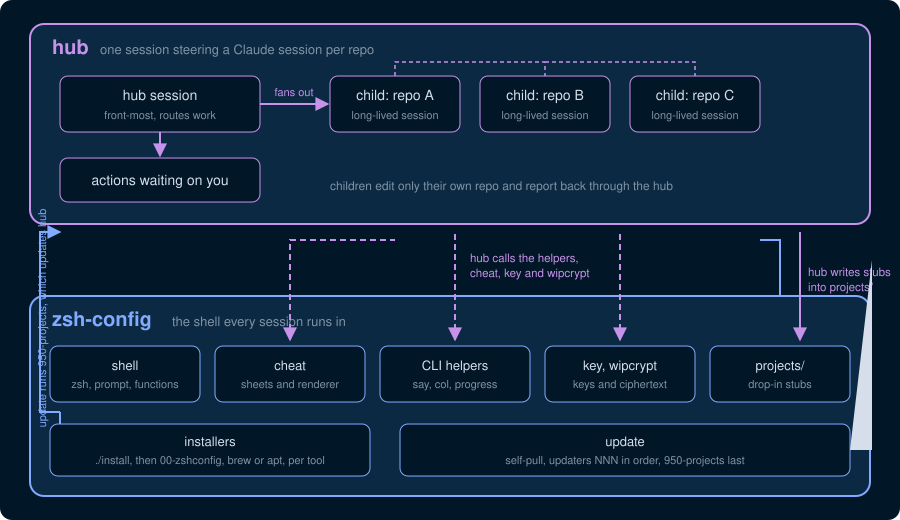

# zsh-config and hub

hub is a separate project: one front session that steers a long-lived Claude session per repository, with actions that wait on you and skills those sessions share. This page covers only how the two projects depend on each other. For the hub workflow, actions and skills, read [hub's own README](https://github.com/jamescodesthings/hub#readme).



## What hub takes from zsh-config

- **Shell stubs.** hub writes `hub.env.zsh` and `hub.zsh` into `projects/` through its `zsh/lib/install-shell-stubs`. The first holds variables and `PATH`, and the second holds aliases and functions. hub rewrites them on every install and removes them when it is uninstalled.
- **CLI helpers.** hub's commands print with `say`, `col`, `progress`, `pick` and `problems`, so they look like every other tool here. The interface is written down in hub's `docs/cli-spec/helpers-interface.md`.
- **Keys.** hub calls `key` to keep its encryption key in the local store and in 1Password. Nothing per project is tracked in this public repository.
- **Encryption.** hub calls `wipcrypt` to encrypt and decrypt its work-in-progress tier. `wipcrypt cycle-key` re-encrypts every root listed in a key's `.users` file.
- **Cheat sheets.** hub's installer calls `link-cheatsheets` to link its own sheets into `~/cheatsheets`. They live in hub, not here, and `cheat hub` finds them.
- **Updating.** `updaters/950-projects` runs last. It pulls every installed project through `hub project update` and runs its installer, which is how hub is updated. It skips when `hub` is missing. `update` never calls `hub update`.

## What zsh-config takes from hub

Nothing is required. zsh-config installs and runs without hub. The drop-in folder is the only hook, and an empty `projects/` is normal.

## Ownership

| Item | Owned by |
| --- | --- |
| `key`, `wipcrypt`, the helpers, the palette | zsh-config |
| `projects/hub*.zsh` stubs | hub |
| hub's cheat sheets | hub |
| `cheat` and `link-cheatsheets` | zsh-config |

## Typical order

```sh
hub down        # stop the sessions
update          # update the machine, hub included
hub             # start again
```

Read hub's README for what those commands do.
