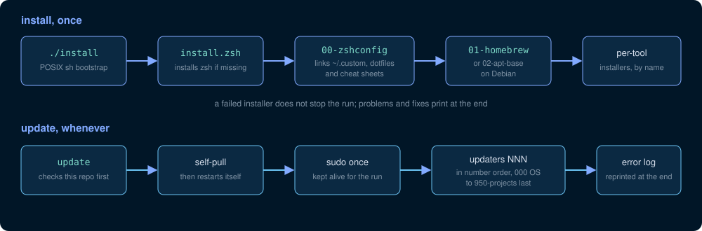
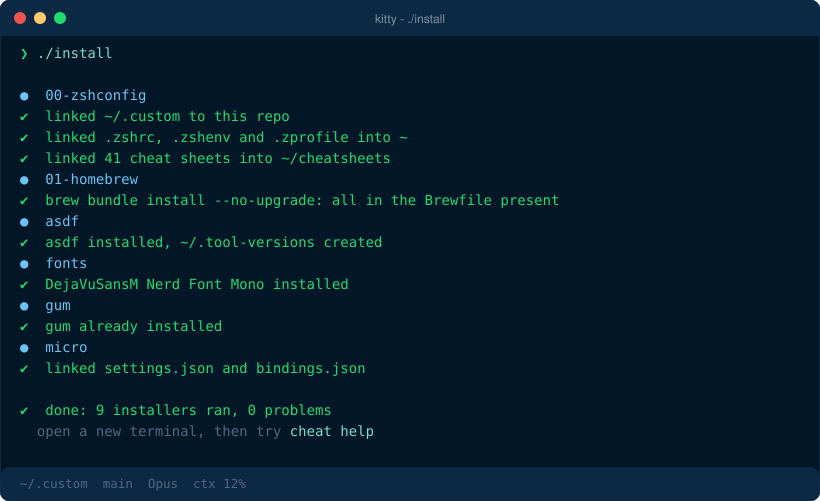
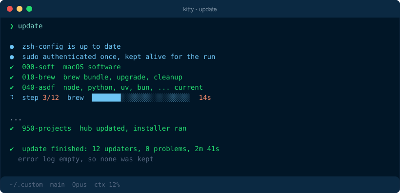
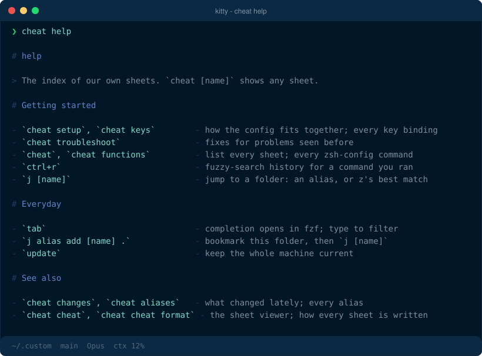

# Install and use

## Install

```sh
git clone https://github.com/jamescodesthings/zsh-config.git ~/projects/zsh-config
cd ~/projects/zsh-config
./install
```

`./install` is plain sh because a fresh Debian may have no zsh. On Debian it installs zsh with apt, and on any other system without zsh it refuses. It then runs `install.zsh`.



The installers run in name order:

1. `00-zshconfig` links the repository to `~/.custom`, links `.zshrc`, `.zshenv`, `.zprofile` and the bash startup files into your home folder, links the cheat sheets, and sets `core.hooksPath` to `hooks`.
2. `01-homebrew` on macOS, or `02-apt-base` on Debian, installs the base tools.
3. The per-tool installers follow: asdf, bat, eza, glow, delta, lazygit, gum, micro, fonts, iTerm2 or kitty, and others.

A failed installer does not stop the run. At the end you get a `problems` block with the count, each problem, and the command that fixes it, and the exit code is 1.



To run one installer only:

```sh
./installers/00-zshconfig
```

Open a new terminal afterwards so `.zshenv` and `.zshrc` are read.

## Update

```sh
update
```

`update` checks this repository first. With local changes or unpushed commits it stops and shows them. On a terminal it offers, default no, to commit and push them. It then pulls, restarts itself on the new scripts, asks for sudo once and runs the updaters in number order.



```sh
update --list           # the updaters in run order
update brew tldr        # only the named ones
update -v               # show each updater's output
update --errors         # the last run's errors, or that it was clean
```

An unknown updater name exits 2 before anything runs. A failed updater is listed at the end and does not stop the rest.

## Use

Start with the index:

```sh
cheat help
```



Things to try:

```sh
cheat                       # list every sheet
cheat search git            # find a sheet by name
cheat git commit            # words join with a dash
cheat functions             # every command in functions/
j alias add work .          # bookmark this folder
j work                      # jump back to it
hist search docker          # find a command you ran before
md-to-pdf notes.md          # markdown to pdf
```

## Manage cheat sheets

```sh
cheat new mytool            # make a sheet from the template and link it
cheat edit mytool           # open it in $EDITOR
cheatsheet-test --strict cheatsheets/mytool.md
```

Sheets follow one structure, shown by `cheat cheat format`. A top sheet has a purpose line, `Getting started`, groups and `See also` last. Run `cheatsheet-test --strict` on every sheet you add or change and fix every failure.

Another repository can ship its own sheets and link them in with `link-cheatsheets`. A name already taken by a real file or another project's link is a clash: it is never overwritten, and a warning is printed.

## Per-machine settings

- `private.zsh` (optional, not committed) is read by every zsh.
- `env.<hostname>.zsh` holds one machine's settings.
- `configs/asdf/update-policy.<hostname>` adds tools for one machine.
- `~/.config/zsh-config/palette.conf` overrides single palette colours.

## Checking a change

```sh
zsh -n path/to/changed-file
zsh -i -c exit
for t in tests/*; do $t || echo "$t failed"; done
```

Without a terminal, the load check prints three known messages (`monitor`, `zle` and `gitstatus`) and still exits 0.
